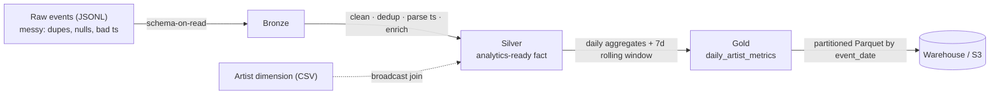

# Creator-Events ETL — a PySpark data pipeline

A batch **ETL pipeline in PySpark** that turns messy, semi-structured engagement
events into a clean, partitioned analytics warehouse — following the standard
**bronze → silver → gold** (medallion) pattern. Runs locally in Spark local mode,
or on a cluster / **AWS EMR reading & writing S3** with only a path change.

> Built as a focused data-engineering artifact. It models the analytics pipeline
> behind a creator app's "North Star" metrics — the same pipeline sketched in my
> product's [system design](https://github.com/sujithsuresh-803/nova/blob/main/SYSTEM_DESIGN.md).

## What it demonstrates

| Skill (from the job description) | Where |
|---|---|
| **Data pipelines** (build & manage) | `src/etl.py` — bronze→silver→gold |
| **Spark** (distributed processing) | PySpark DataFrame API + Spark SQL |
| **ETL concepts** | schema-on-read, cleaning, dedup, conforming, enrichment |
| **Data modeling** | fact table + broadcast dimension join; partitioned gold table |
| **SQL** | `sql/metrics.sql` — CTEs, window functions (`ROW_NUMBER`, `LAG`, rolling sums) |
| **Massive-scale patterns** | explicit schemas, broadcast joins, partition pruning, tuned shuffle partitions |
| **S3 / distributed storage** | `s3a://` input/output (see below) — same code, cloud paths |

## Pipeline



- **Bronze** — read raw JSONL with an **explicit schema** (never infer in prod).
- **Silver** — parse timestamps, drop bad rows, **dedupe to exactly-once** with a
  `row_number()` window, and **enrich** via a broadcast join to the artist dim.
- **Gold** — daily per-artist metrics (streams, saves, follows, unique listeners,
  engagement score) plus a **7-day rolling momentum** metric, written as
  **date-partitioned Parquet**.

## Run it locally

```bash
pip install -r requirements.txt          # needs Java 11/17 for Spark

# 1) generate ~200k messy raw events + an artist dimension
python src/generate_data.py --events 200000 --artists 500

# 2) run the pipeline
python src/etl.py \
  --input   data/raw/events.jsonl \
  --artists data/dim/artists.csv \
  --output  data/warehouse/daily_artist_metrics
```

You'll see a data-quality report (bronze rows read vs. silver rows kept), an
"events by archetype" summary, and a partitioned Parquet table in
`data/warehouse/`.

## Run it on AWS (EMR + S3)

The code is cloud-ready — only the paths change:

```bash
spark-submit \
  --packages org.apache.hadoop:hadoop-aws:3.3.4 \
  src/etl.py \
  --input   s3a://my-bucket/raw/events/ \
  --artists s3a://my-bucket/dim/artists.csv \
  --output  s3a://my-bucket/warehouse/daily_artist_metrics/
```

Because the gold table is **partitioned by `event_date`**, downstream queries
(Athena / Spark SQL / Redshift Spectrum over the same S3 prefix) prune partitions
and only scan the days they need.

## Project layout

```
creator-events-etl/
├─ src/
│  ├─ generate_data.py   # synthesize a messy raw dataset (dupes, nulls, bad rows)
│  └─ etl.py             # the PySpark bronze→silver→gold pipeline
├─ sql/
│  └─ metrics.sql        # analytical queries (CTEs + window functions)
├─ requirements.txt
└─ README.md
```

## Design notes / trade-offs
- **Explicit schema over inference** — deterministic, faster, and fails loudly on
  drift.
- **Broadcast join** for the small dimension avoids a shuffle.
- **`row_number()` dedup** gives exactly-once semantics on replayed/duplicated events.
- **Partitioned Parquet** is the columnar, prune-friendly warehouse standard.
- Shuffle partitions are set low (8) for local runs — raise on a real cluster.
